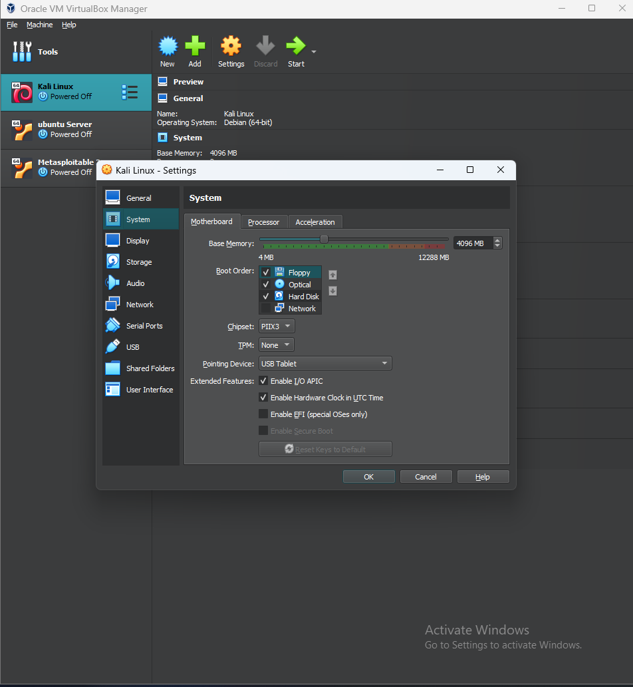
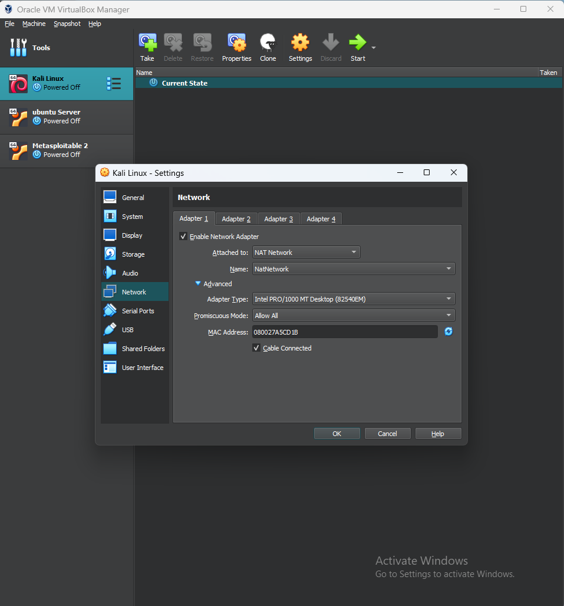

# NETWORKWALKS-SAMUEL-B082-WK-PM1-CYBERSECURITY-LAB-SETUP
# Cybersecurity Lab Setup: Kali Linux on Oracle VirtualBox

## Overview
This repository documents the step-by-step setup and configuration of an isolated home cybersecurity laboratory environment. The primary focus of this project is establishing a safe, controlled workspace for conducting authorized penetration testing exercises, mastering Linux Command Line Interface (CLI) operations, analyzing network traffic, and inspecting HTTP requests using Burp Suite.

> **Note:** This repository represents an educational hands-on learning lab and is intended solely for security research and practice in an authorized, isolated environment.

---

## Learning Objectives
- **Isolated Lab Environment:** Build and configure a isolated virtual sandbox to safely perform security assessments without exposing host systems or external networks.
- **Linux Mastery:** Enhance proficiency with the Linux terminal and system administration within a Kali Linux environment.
- **Traffic Analysis:** Practice capturing, analyzing, and inspecting network protocols and packet data.
- **Web Security:** Learn web application security testing by configuring proxy interceptors to inspect and manipulate HTTP requests/responses using Burp Suite.

---

## Technical Specifications & Architecture

### Host Machine Specs
- **Operating System:** Windows 11
- **Installed RAM:** 12 GB
- **Virtualization Software:** Oracle VM VirtualBox

### Virtual Machine Configuration (Kali Linux)
- **Guest OS:** Kali Linux
- **Allocated Memory (RAM):** 4 GB (4096 MB)
- **Allocated Processor Cores:** 2 vCPUs (out of 4 host threads)
- **Virtual Storage:** 80 GB Virtual Hard Disk (VDI)
- **Network Adapter Mode:** `NAT Network`

---

## Networking Configuration
The lab utilizes VirtualBox's **NAT Network** mode rather than standard NAT. This configuration allows:
1. Outbound internet access for updating system packages and installing tools.
2. Direct IP communication between multiple virtual machines on the same private sub-network, preparing the lab for multi-VM attack/defense scenarios.

## 📷 Screenshots & Visual Evidence

- **VirtualBox Configuration:**
  

- **Kali Linux Desktop & Interface:**
  

- **Network Interface Configuration:**
  

- **Network Settings & Routing:**
  
---

## Installation & Setup Steps

1. **Hypervisor Installation:**
   - Downloaded and installed Oracle VM VirtualBox on Windows 11 host.
2. **Virtual Machine Creation:**
   - Created a new VM profile for Kali Linux.
   - Provisioned 4 GB RAM, 2 CPU cores, and an 80 GB dynamically allocated virtual drive.
3. **OS Installation & Customization:**
   - Mounted the Kali Linux ISO image and executed a custom Debian-based system installation.
   - Configured non-root user credentials and localized system options.
4. **Network & Tool Setup:**
   - Configured the adapter settings to use a custom NAT Network interface.
   - Configured and tested Burp Suite HTTP proxy setup with local browser trust settings.

---

## Challenges & Solutions

### 1. VirtualBox Shared Folder Permissions
- **Issue:** Unable to access shared folders directly between the Windows 11 host and the Kali Linux guest operating system.
- **Solution:** Guest Additions needed proper installation, and the non-root user account required explicit membership in the `vboxsf` user group. Running `sudo usermod -aG vboxsf $USER` and rebooting resolved the permission restrictions.

### 2. Network Mode Configuration (NAT vs. NAT Network)
- **Issue:** Transitioning from default `NAT` to `NAT Network` initially caused connection drops and IP lease issues.
- **Solution:** Created and defined a global NAT Network interface within VirtualBox's *Tools > Network Manager* prior to attaching the Kali VM network interface to the newly created adapter.

---

## Future Enhancements & Roadmap
- [ ] Deploy **Metasploitable 2/3** target machine on the NAT Network for vulnerable service testing.
- [ ] Add an **Ubuntu Server** node for monitoring, log analysis, and syslog deployment.
- [ ] Integrate a **Windows 10** endpoint target to practice Active Directory and Client-side exploitation workflows.
- [ ] Implement Wireshark capturing filters and document baseline network captures.

---

## Author & Acknowledgements
- **Author:** Samuel Okusanya
- **GitHub Repository:** [NETWORKWALKS SAMUEL-B082-WK-PM1-CYBERSECURITY-LAB-SETUP](https://github.com/samuel-okusanya/NETWORKWALKS-SAMUEL-B082-WK-PM1-CYBERSECURITY-LAB-SETUP)
- **Program / Context:** Networkwalks Cybersecurity Training

---

## Disclaimer
The activities documented in this project are conducted strictly within a controlled lab environment for legitimate educational purposes. Unauthorized testing against systems without explicit permission is illegal and unethical.
